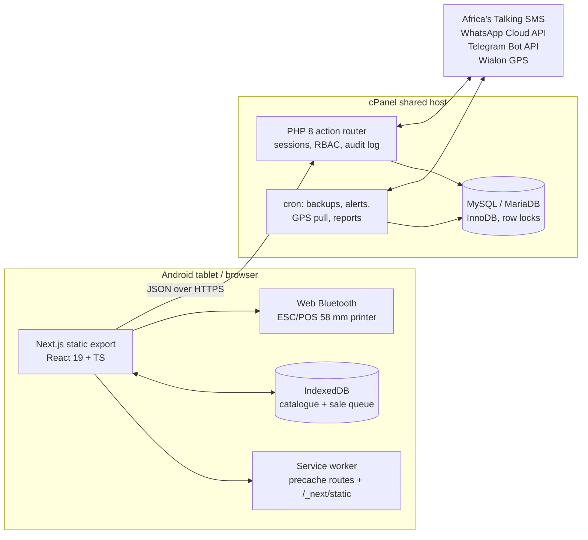

<h1>Adam Chhatbar</h1>

**Founder & Lead Engineer, [Offset Technologies](https://offsettechs.com)** · Arusha, Tanzania · since 2016

I design and build transactional business systems for East African retail, pharmacy and safari operators: append-only stock ledgers, idempotent offline sync, multi-tenant isolation and GPS telemetry pipelines. All of it runs on commodity cPanel hosting with no Node runtime, behind connections that drop several times a day.

`TypeScript` `Next.js 15/16` `React 19` `PHP 8 (strict_types)` `MySQL/MariaDB` `Prisma` `IndexedDB` `Service Workers` `Web Bluetooth`

---

### Architecture

One pattern across five products: a static front end served from the web root, a single PHP endpoint that dispatches `?action=` to `act_*` handlers, and MySQL as the only state. Deploys are a zip upload. No build step or process manager on the server.

---

### Systems

| System | Domain | Scale of the codebase | Stack |
|---|---|---|---|
| **Msafara** | Safari fleet & operations, multi-tenant SaaS | 59 tables · 97 automated checks (11 security) | Vanilla JS · PHP 8.1 · MariaDB · Leaflet |
| **[Rahisi Auto](https://rahisiautocenter.online)** | Spare-parts POS, inventory, workshop | 35 tables · 193 end-to-end API tests | Next.js 15 · TS · PHP 8 · MySQL |
| **[DawaFlow](https://dawaflowtz.online)** | Pharmacy ERP, multi-branch SaaS | 40 Prisma models | Next.js · Prisma · SQLite · Node 24 |
| **Zana** | Hardware retail, rentable multi-tenant | Same core stack as Rahisi | Next.js 15 · TS · PHP 8 · MySQL |
| **Business Manager** | SME sales & CRM, deployed for [Shamba Lulu](https://shambalulu.online) and [Naturaw](https://naturawskinco.store) | Base system customised per client | Next.js 16 · Radix UI · PHP 8 · MySQL |

Source is private. Architecture walkthroughs and live demos on request.

---

### Engineering notes

**Offline-first point of sale (Rahisi, Zana).** A service worker precaches every till route and the hashed `/_next/static` chunks it references, serves pages network-first with cache fallback, and never caches `/api/`. Sales made offline go to an IndexedDB queue with a device-generated UUID and a provisional receipt number (`OFF-<device>-<seq>`). Sync sends batches of 20. The server checks `client_uuid` before inserting, so a retry after a dropped response cannot record a sale twice. Wholesale and transfers are refused offline by design, because they need live stock across branches.

**Stock as a ledger.** Quantities change only through `stock_moves` rows (`from_branch`, `to_branch`, `qty`, `kind`, reference). `stock_balances` is a cached projection. A verification job recomputes every variant/branch balance from the ledger with a `UNION ALL` aggregate and reports any drift. Money is stored as integer shillings, so totals carry no float error.

**Concurrency.** Document numbers come from `INSERT … ON DUPLICATE KEY UPDATE n = LAST_INSERT_ID(n + 1)` on a counters table: one atomic statement, so two tills can never issue the same number. Voids, quote conversions and commission payouts take `SELECT … FOR UPDATE` locks inside a transaction. Any thrown error rolls back the open transaction before the JSON error is returned. Duplicate-key violations map to HTTP 409.

**Multi-tenancy (Msafara, Zana).** Every row carries `company_id`, and the data-access helpers append it to every read and write. Tenant state drives access: an expired subscription keeps read and export access for 14 days, and a suspended tenant gets HTTP 402 at once. Platform staff can enter a tenant in support mode with the owner's rights, and the audit log records the Offset user who did it.

**GPS telemetry (Msafara).** Positions arrive by Wialon pull (cron, every 5 min) or tracker push with a per-tenant token compared in constant time. `INSERT IGNORE` deduplicates replays. Each fix is tested against circular zones (haversine, highest priority then smallest radius wins) for speed limits and park hours, against the trip's route corridor, and against fuel-level drops while stationary. Speeding events are debounced per burst and keep the peak value.

**Security baseline.** Parameterised SQL everywhere, with sort and filter keys whitelisted against known columns. bcrypt hashes with rehash on login. Login throttling per IP and per account, with timing kept equal for unknown accounts. HTTP-only SameSite cookies and session ID regeneration on sign-in. A required custom header on every state-changing POST blocks CSRF. CSP, HSTS and frame-deny headers. Server-side RBAC on every action, including a read-only accountant role. Audit log with before/after JSON per change.

**Self-applying schema upgrades.** Each release ships a `SCHEMA_VERSION`. The first request after upload runs idempotent, additive migrations (`information_schema` checks before `ALTER TABLE … ADD COLUMN`), so updating a client install means uploading a zip.

**Hardware.** Receipts print over Web Bluetooth to 58 mm BLE thermal printers through a small ESC/POS byte builder (alignment, emphasis, double-size text, Code 128 barcodes). Barcode scanners work in keyboard-wedge mode in every search field.

**Localisation.** Full English/Kiswahili UI. A `check:i18n` script fails the release if any key lacks a Kiswahili string, and system alerts are stored in both languages.

---

### Stack

| Area | Tools |
|---|---|
| Languages | TypeScript, PHP 8 (strict types), SQL, JavaScript |
| Front end | Next.js (static export), React 19, Tailwind CSS 4, Radix UI, Leaflet, Chart.js, ApexCharts |
| Back end & data | PHP action-router APIs over PDO, MySQL/MariaDB (InnoDB), Prisma, SQLite |
| Browser platform | Service Workers, IndexedDB, Web Bluetooth, PWA manifests |
| Ops | cPanel/LiteSpeed, Let's Encrypt (acme.sh), cron, PowerShell packaging and SSH deploys, nightly compressed dumps with rotation |
| Integrations | Africa's Talking SMS, M-Pesa / Mixx / Airtel / HaloPesa reconciliation, WhatsApp Cloud API, Telegram Bot API (webhooks), Wialon |

---

### Writing

- [How to Choose the Right Business Management System in Tanzania](https://offsettechs.com/insights/) · Oct 2026
- [7 Things Every Business Website in Tanzania Needs to Win Customers](https://offsettechs.com/insights/) · Oct 2026
- [Digital Marketing for Tanzanian Businesses: Where to Start](https://offsettechs.com/insights/) · Nov 2026

---

### Contact

[offsettechs.com](https://offsettechs.com) · [inquiries@offsettechs.com](mailto:inquiries@offsettechs.com) · [WhatsApp](https://wa.me/255686294959)
